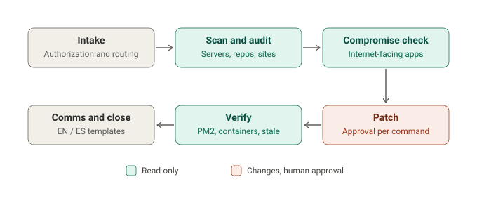

# node-vuln-responder

Scan, patch, verify and check for compromise after Node.js security releases, with AI
agents doing the legwork and a human approving every change.

Ships ready for the **October 2026 Node.js security release**: 10 CVEs, highest
severity High, including a Brotli decoder remote code execution (CVE-2026-111497).
Fixed in **26.12.1, 24.22.1, 22.23.4**. Node 20 and older (plus 21, 23, 25) are
end-of-life and get no fix.



## Why Node needs a different approach

Node servers almost never reveal their version over HTTP, and Node lives in many places
at once: servers, version managers, Docker images, CI and serverless platforms. So the
scanner works mostly from the inside:

| Mode | Looks at |
|---|---|
| `--local` | Every Node on the machine (system, NodeSource, nvm, fnm, Volta, asdf, mise, n, Homebrew, cPanel/CloudLinux/Plesk) and running processes still on an old binary |
| `--project <dir>` | `.nvmrc`, `package.json` engines, Dockerfiles, compose, GitHub Actions, Netlify, Lambda/Terraform runtimes |
| `site.com` | Finds which sites run Node (Express, Next.js, Nuxt, Vercel, Netlify) so you know where to look |

## What's inside

| | |
|---|---|
| **Skills** | `nvr-navigator` (start here), `nvr-fleet-scan`, `nvr-server-audit`, `nvr-patch`, `nvr-compromise-check`, `nvr-verify-close`, `nvr-client-comms` (EN/ES), `nvr-advisory-update` |
| **Scripts** | `scan.sh`, `detect-stack.sh`, `patch-plan.sh`, `ioc-hunt.sh`, `verify.sh`. Read-only, bash + curl only |
| **Standalone** | `standalone/node-sec-check.sh`: one file to share with anyone |
| **Claude Code** | `/nvr` commands, `nvr-verifier` agent, safety hook |
| **Advisory** | `advisories/nodejs-2026-10.env`. One file drives everything; next release = new file |

## Install

```bash
# Claude Code (full plugin)
/plugin marketplace add luivc1/node-vuln-responder
/plugin install node-vuln-responder@node-vuln-responder

# Hermes, or any Agent Skills folder
./install.sh --target hermes
./install.sh --dest /path/to/skills
```

Other agents: point them at [`AGENTS.md`](AGENTS.md).

## Quick start (no agent)

```bash
S=~/.node-vuln-responder/scripts
bash $S/scan.sh --local --project ~/code -o node-report   # color HTML + CSV
bash $S/scan.sh -f sites.txt                              # which sites run Node
bash $S/patch-plan.sh                                     # prints commands, runs nothing
sudo bash $S/ioc-hunt.sh                                  # was it compromised?
bash $S/verify.sh                                         # binaries, PM2, containers
```

Or ask your agent: *"Are my Node apps affected by the October 2026 Node.js security
release?"* / *"¿Mis apps de Node están vulnerables?"*

## Statuses

`PATCHED` · `VULNERABLE` · `EOL` (no fix, upgrade major) · `STALE` (running old binary,
restart) · `FLOATING` (gets the fix only after reinstall/rebuild/redeploy) · `MANAGED`
(platform runtime) · `CHECK` · `HIDDEN` · `NO-NODE`

## Safety

- Scripts never change anything. Every change is shown and approved one command at a time.
- No exploit code, ever. Verification is by version evidence.
- Evidence is copied before anything is removed; secrets are never printed.
- Only scan systems you own or are authorized to assess.

More responders in this set: [php-vuln-responder](https://github.com/luivc1/php-vuln-responder) ·
[railway-secrets-responder](https://github.com/luivc1/railway-secrets-responder) ·
[python-cert-responder](https://github.com/luivc1/python-cert-responder) ·
[python-vuln-responder](https://github.com/luivc1/python-vuln-responder)

## License

[MIT](LICENSE) © 2026 Innovatask LLC
